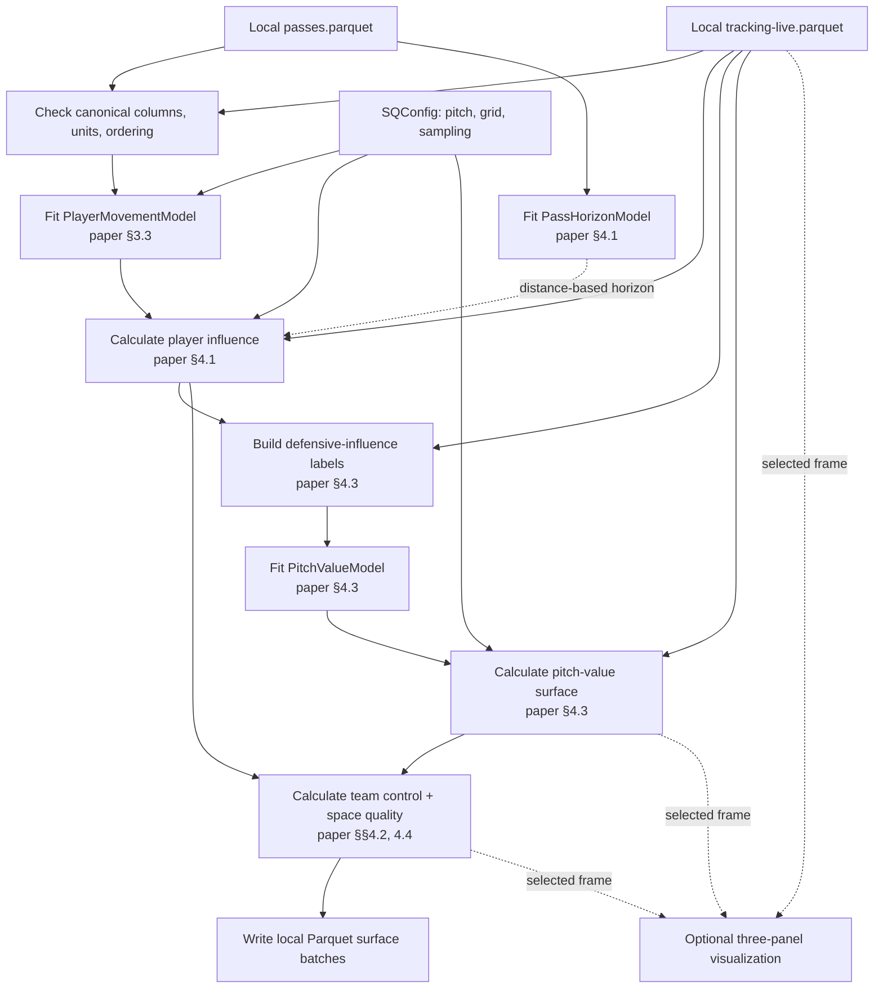

# Local Parquet example pipeline

This walkthrough assumes you have saved your prepared tracking data in a folder called `queried-data` within your working directory. It does not connect to a database or tracking
provider: all reads and writes happen at local paths that you choose. The
companion [`examples/example.py`](../examples/example.py) is the runnable
version of the same workflow; its command-line options let you choose the
input/output paths and analysis settings.

The example expects the canonical tracking table limited to valid rows in `tracking-live.parquet`
and completed-pass data in `passes.parquet`. These files are private inputs.
If your local files use other names, pass those names to the example's
`--tracking-file` and `--passes-file` options, or update the code below accordingly.
`tracking-live.parquet` must follow the public tracking schema in the
[README](../README.md#tracking-input-columns); pass data must have
`pass_distance_m` in meters and `pass_duration_seconds` in seconds.

## Workflow at a glance



The paper references are short labels to keep the conceptual connection
visible: §3.3, “Data-Driven Movement Models”; §4.1, “Influence of the Player”;
§4.2, “Pitch Control”; §4.3, “Pitch Value”; and §4.4, “Space Quality.”
SQmdb does **not** implement the paper's §5 “Space Generation” analyses.
These labels identify related stages, they're not a claim that SQmdb reproduces every
paper method or result.

## 1. Read local inputs and set the pitch grid

Install SQmdb from PyPI in the Python environment used for the analysis:

```bash
python -m pip install --upgrade sqmdb
```

In the script, choose the existing `queried-data` directory and an empty
output directory outside it. Then let Polars scan the local Parquet files.
`scan_parquet` creates LazyFrames, so Polars can defer reading rows until an
operation needs them. No source-specific query or connection is part of this
step.

```python
from pathlib import Path

import polars as pl
from sqmdb import SQConfig

queried_data_dir = Path(r"C:\path\to\sqmdb-results\your-run\queried-data")
output_dir = Path(r"C:\path\to\sqmdb-results\your-run\sqmdb-surfaces")

tracking = pl.scan_parquet(queried_data_dir / "tracking-live.parquet")
passes = pl.scan_parquet(queried_data_dir / "passes.parquet")

config = SQConfig(
    pitch_length_m=105.0,
    pitch_width_m=68.0,
    frame_rate=25.0,
    grid_resolution_m=2.0,
    frame_stride=25,
    batch_frames=5,
)
```

Use the verified pitch dimensions and orientation for your tracking data; the
values above are examples. `frame_stride=25` selects approximately one output
frame per second for 25 Hz data. `batch_frames=5` asks iterator-based steps to
yield up to five selected frames per output batch. The complete script also
checks that the input files exist and refuses to write into the input folder
or a non-empty output folder.

## 2. Fit movement and pass-time models

The left branch of the diagram learns movement tendencies from historical
tracking. `fit_player_movement_model` returns the fitted
`PlayerMovementModel`; `sample_stride` controls which observations contribute
to fitting. The pass branch learns an estimated pass duration from pass
distance. The package uses that estimate to choose a movement horizon based
on each player's distance to the ball.

```python
from sqmdb import PassHorizonModel, fit_player_movement_model

movement_model = fit_player_movement_model(
    tracking,
    config,
    sample_stride=5,
)
pass_horizon_model = PassHorizonModel.fit(passes)
```

Pass fitting requires at least 10 finite completed passes, two or more
distinct non-negative distances, and positive durations. If those data are
unavailable, the influence step can use a fixed `horizon_seconds` instead.
Section §3.3 of Martens, Dick, and Brefeld (2021) describes data-driven
movement models; §4.1 connects a player's movement influence to a
distance-conditioned time horizon. SQmdb implements practical approximations
of these ideas, as described in the [API manual](api-guide.md).

## 3. Calculate influence and create pitch-value labels

`iter_player_influence` calculates a long-form grid surface for each player
in the selected tracking frames. Its iterator form yields bounded batches.
`iter_defensive_influence_samples` matches those batches to frame-level
possession and ball information and produces the defensive-influence labels
used to train the pitch-value model.

The example writes each label batch to a local Parquet part. Keeping parts
separate avoids concatenating the full history in memory.

```python
from sqmdb import (
    iter_defensive_influence_samples,
    iter_player_influence,
)

labels_dir = output_dir / "defensive-influence-labels"
labels_dir.mkdir(parents=True, exist_ok=True)

label_row_count = 0
for part, label_batch in enumerate(
    iter_defensive_influence_samples(
        iter_player_influence(
            tracking,
            movement_model,
            config,
            horizon_model=pass_horizon_model,
        ),
        tracking,
    ),
    start=1,
):
    label_batch.write_parquet(labels_dir / f"part-{part:06d}.parquet")
    label_row_count += label_batch.height
```

The labels represent the defending players' influence, aggregated per frame
and grid cell, capped at one. If no labels are produced, inspect the input
frame metadata and selected rows before fitting. The conceptual link to §4.3
is that the article learns defensive influence from historical situations as
an input to pitch value.

## 4. Fit pitch value and calculate its surface

The fitted pitch-value model predicts defensive influence from the ball and
grid-cell positions. SQmdb then scales these predictions by the cell's
distance from the opponent's goal. Fitting is eager, so the example scans
the saved label parts and sets an upper bound on the training rows.

```python
from sqmdb import PitchValueModel, iter_pitch_value

pitch_value_model = PitchValueModel.fit(
    pl.scan_parquet(str(labels_dir / "*.parquet")),
    max_training_samples=1_000_000,
)

pitch_value_batches = iter_pitch_value(tracking, pitch_value_model, config)
```

The iterator yields long-form `pitch_value` rows for each selected frame and
grid cell. The paper's §4.3 is titled “Pitch Value”; SQmdb's model is a
scikit-learn multilayer perceptron and does not reproduce every paper training
detail.

## 5. Combine surfaces and save Parquet parts

The final branch combines player influence and pitch value. `space_quality`
aggregates player influence by team, calculates team pitch control, and
multiplies control by pitch value. The script processes matching influence
and value batches together, then writes the inputs and combined result to
separate local folders.

```python
from itertools import zip_longest

from sqmdb import iter_player_influence, space_quality

influence_batches = iter_player_influence(
    tracking,
    movement_model,
    config,
    horizon_model=pass_horizon_model,
)
influence_dir = output_dir / "player-influence"
value_dir = output_dir / "pitch-value"
quality_dir = output_dir / "space-quality"
for directory in (influence_dir, value_dir, quality_dir):
    directory.mkdir(parents=True, exist_ok=True)

sentinel = object()

for part, (influence_batch, value_batch) in enumerate(
    zip_longest(influence_batches, pitch_value_batches, fillvalue=sentinel),
    start=1,
):
    if influence_batch is sentinel or value_batch is sentinel:
        raise RuntimeError("The surface iterators returned different batch counts.")

    frame_keys = ["match_id", "frame_id", "grid_i", "grid_j"]
    influence_frames = (
        influence_batch.select(*frame_keys).unique().sort(frame_keys)
    )
    value_frames = value_batch.select(*frame_keys).unique().sort(frame_keys)
    if not influence_frames.equals(value_frames):
        raise RuntimeError("The surface batches contain different frames or grid cells.")

    quality_batch = space_quality(influence_batch, value_batch)
    influence_batch.write_parquet(
        influence_dir / f"part-{part:06d}.parquet"
    )
    value_batch.write_parquet(
        value_dir / f"part-{part:06d}.parquet"
    )
    quality_batch.write_parquet(
        quality_dir / f"part-{part:06d}.parquet"
    )
```

In a complete script, create those three output subdirectories before writing
and check that the corresponding batches contain the same frame and grid
keys. Keep your pitch dimensions, grid settings, coordinate orientation, and
SQmdb version with your own analysis so the saved surfaces can be interpreted
and reproduced. This workflow covers the paper's §§4.2 and 4.4 concepts of
pitch control and space quality; it does not calculate the later §5 space
generation metrics.

## 6. Optional: visualize a selected frame

Install the optional plotting dependencies:

```bash
python -m pip install --upgrade "sqmdb[visualization]"
```

Compute velocities for the full tracking sequence before selecting one frame.
Load the matching Parquet surface parts. The `space_quality` output contains
both `team_pitch_control` and `space_quality`, so it can supply the first and
third plot inputs. `plot_pitch_surfaces` returns the Matplotlib figure and
axes so you can further customize or save the chart.

```python
from sqmdb import add_plot_velocities, plot_pitch_surfaces

tracking_with_velocity = add_plot_velocities(tracking, config)
frame_id = 1200
tracking_frame = tracking_with_velocity.filter(pl.col("frame_id") == frame_id)
control_and_quality = pl.scan_parquet(
    str(output_dir / "space-quality" / "*.parquet")
)
pitch_value_surface = pl.scan_parquet(
    str(output_dir / "pitch-value" / "*.parquet")
)

figure, axes = plot_pitch_surfaces(
    control_and_quality,
    pitch_value_surface,
    control_and_quality,
    tracking_frame,
    frame_id=frame_id,
    team_id="team-a",
    config=config,
)
```

The visualization is optional and is not required for calculating or saving
surfaces. See the [API manual](api-guide.md) for all plot arguments and
column requirements.

## Keep inputs and outputs private

The input Parquet files and every generated label/surface directory may
contain sensitive or row-level data. Keep them outside the public source
repository and package; do not attach them to issues, pull requests, or
documentation. The example never embeds local query results or credentials,
and it refuses to write into the `queried-data` input directory.

## Paper reference

Martens, F., Dick, U., & Brefeld, U. (2021). *Space and Control in Soccer*.
Frontiers in Sports and Active Living, 3, 676179.
[https://doi.org/10.3389/fspor.2021.676179](https://doi.org/10.3389/fspor.2021.676179)
