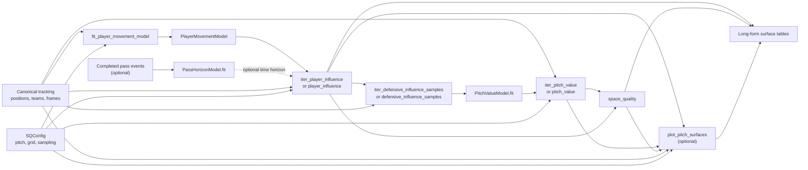

# SQmdb public API flow

This diagram summarizes the normal path through SQmdb. The left-to-right
branches distinguish movement model training, optional pass-time estimation,
pitch-value training, and frame-level surface calculation. The charting step is
optional and requires the `visualization` extra.

Iterator functions yield surface tables incrementally; their non-iterator
counterparts collect those batches into one table. `SQConfig.grid()` provides
the cell-center coordinates used by each surface. `space_quality` is a
team-level result; player-level influence remains available separately.
